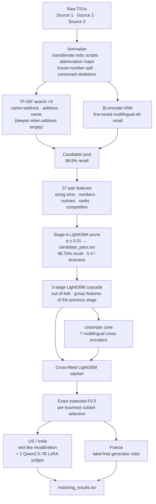

# Doppelganger

### Amazon ML Challenge 2026 · Rank 38 of 32,000+ teams · Team Minutes

> *Every business has look-alikes. Some are its real copies; the rest are decoys built to fool you. Doppelganger tells them apart.*

**Matching 10 million noisy business records to 1.7 million reference businesses across the US, India and an unlabeled France, with a retrieval → gradient-boosting → cross-encoder → exact-F0.5 pipeline built entirely on free compute.**


-2ea44f)


Team **Minutes**: Gowrawaram Karthik Koundinya (team lead), Macha Jayanth, M V Abhiram, Hasanabada Sirichandana.

---

## TL;DR

| | |
|---|---|
| **Final standing** | **Rank 38 of 32,000+ teams** (top 50; the team was invited to an Applied Scientist Intern interview) |
| **Best public leaderboard score** | **0.990162** macro F0.5 (from 0.921 for our first submission) |
| **Validation (held-out half B)** | 0.991316 for the stacked model; US + India measured on test at 0.9913, the same as validation |
| **Candidate recall** | 98.75% of true matches kept with ~5.4 candidates per business (9.37M scored test pairs) |
| **France (no labels)** | label-free, generator-aware rules lifted the leaderboard by +0.0039 (France ≈ 0.953 → ≈ 0.979) |
| **Compute budget** | free tiers and promotional credits only: AWS EC2, Kaggle 2×T4, Modal H100, Lightning AI, one laptop RTX 4060 |

The three ideas that mattered most:

1. **Solve the reverse problem.** Every Source 2/3 record belongs to *at most one* Source 1 business (true for all 7.64M training pairs), so we ask each record "which business are you a copy of, if any?" and group the answers.
2. **A validation set that behaves like the test set** — in how many unmatched records it holds *and* in what kind they are. Every decision was tuned on it, and it agreed with the test set to four decimals for US + India.
3. **Model the data generator, not just the data.** France had no labels; we derived rules from how the generator writes copies and decoys and confirmed each with two independent label-free statistical tests.

---

## The problem

Three sources of business records share **no identifiers**. Each record has four fields:

| column | description |
|---|---|
| `entity_id` | opaque id with an `S1-`, `S2-` or `S3-` prefix |
| `business_name` | free text: case/accent changes, legal-form variants, typos, reordered words, aliases (`d/b/a`), initials, web handles, Indic scripts (Devanagari, Bengali, Telugu, Tamil, Kannada) |
| `business_address` | free text: abbreviations, reordered components, missing postcodes, landmarks, house-number typos; ~3.4% empty |
| `country` | US, India (train + test); **France appears only in test, with no labels** |

**Source 1** is a clean reference list. **Sources 2 and 3** contain noisy copies of those businesses *plus decoys* designed to look plausible (near-duplicate names, the same name at a different address, and in France "sibling" records at the same address with one distinctive word swapped).

**Task.** For every Source 1 business, output the set of S2/S3 records that are copies of it (possibly empty), plus the candidate set the model actually scored.

**Metric.** Macro **F0.5** averaged over *every* Source 1 business, singletons included:

```
F0.5 = 1.25·TP / (1.25·TP + FP + 0.25·FN)       empty truth + empty prediction = 1
```

A false match costs four times as much as a missed one, and an empty prediction is only rewarded when the business truly has no copies.

**Scale.** Train: 2.21M Source 1 businesses, 10.32M S2/S3 records, 7.64M true pairs. Test: 1.73M businesses (259k French), 9.97M S2/S3 records — with ~5.8 records per business versus 4.7 in training.

> **Data is not included.** The competition dataset is not redistributable. Participants obtain it from the Amazon ML Challenge 2026 student resource; this repository contains code and documentation only.

---

## Architecture



---

## Pipeline and design decisions

| Stage | What it does | Why |
|---|---|---|
| **Normalisation** (`ber/normalize.py`) | Unicode transliteration of Indian scripts, US/India/France abbreviation maps, legal-suffix handling, `45BIS → 45 bis`, consonant skeletons so that transliterations agree | Spelling variants of one business must collide before any model sees them |
| **Blocking** (`ber/pipeline.py`, `ber/neural.py`) | Per country: three pooled hashed TF-IDF searches (name+address top 10, address top 15, name top 8 → 40 for empty addresses) + a fine-tuned `multilingual-e5-small` bi-encoder (top 5) + exact/one-edit name lookup for empty-address records | One TF-IDF search kept 95.5% of true pairs; the union keeps 98.9%. The bi-encoder reads Indic scripts natively |
| **Pruning** (`ber/stage2.py`) | Compact LightGBM (150 trees, 31 leaves) drops candidates with p < 0.01 | Keeps 98.75% of true pairs at 4.82 candidates/business (train); the pruned set *is* the audited `candidate_pairs.tsv` |
| **3-stage cascade** (`ber/stage2.py`) | Stage 1: two out-of-fold LightGBMs. Stages 2 and 3 add group features from the previous stage's out-of-fold probabilities: rank/share within the record, margin to runner-up, mass other records already place on the business, confident competing claims | A record's match depends on how strongly *other* records claim the same business |
| **Cross-encoders** (`kaggle/`, `scripts/modal_ce.py`, `ber/ce_data.py`) | 7 fine-tuned pair classifiers on the uncertain zone: e5-small, 2× e5-base, e5-large, 2× bge-reranker-v2-m3, Qwen3-Reranker-0.6B | Trained only on records that never touch a validation business — so the stacker learns from honest scores |
| **Stacker** (`ber/blend.py`) | 15-leaf LightGBM over the stage-3 logit, every CE logit, margins, per-business/record CE mass and raw similarities; cross-fitted on validation half A | Half B is never used for any choice and gives the reported score |
| **Decision** (`ber/decide.py`) | Each record goes to its most probable business; per business, choose the top-k that maximises the **exact expected F0.5** (Poisson-binomial dynamic programme), probabilities sharpened by γ = 1.5; generator caps (≤5 from S2, ≤6 from S3) | Optimises the per-business, precision-weighted metric directly instead of a global threshold |
| **France** (`scripts/france_*.py`, `scripts/fr1*_build.py`) | Remove same-address one-word swaps to another French vocabulary word (sibling decoys), remove records at the generator's decoy house-number offsets, add generic-word swaps, parse-gap copies and brand/initials copies at single-business addresses | Each rule confirmed by two label-free markers (below) |
| **Test-like recalibration** (`scripts/resid_model.py`, `scripts/ui_recon.py`, `lightning/lora_judge.py`) | Residual LightGBM on the uncertain zone with generator-operation features, label-free "orphan" features and the mean logit of two Qwen2.5-7B LoRA judges | +0.00037 (95% CI [+0.00025, +0.00050]) on test-like half B; confirmed on the leaderboard |
| **Structural additions** (`scripts/deep/`, `scripts/agent_*`, `scripts/generic_add.py`) | One-token names (initials, handles, brand names) at the only business at an address, empty-address unique-name matches, Indic transliteration matches, learned tie-breakers | Each rule measured on training truth (95–100% precision) and applied only to still-unassigned records |

### Validation that tracks the test set

- **Split by business, never by pair:** `hash(entity_id, seed 42) % 10 == 0`; half A chooses everything, half B only reports.
- **Match test density:** the test set has ~5.8 S2/S3 records per business vs 4.7 in train (≈40% unmatched vs 26%), so training hides 19% of Source 1 businesses from the candidate pool.
- **Match test difficulty:** the decision rule is chosen on a "hard" metric that counts every false match from an unmatched record three times.
- **Match the *kind* of unmatched records:** empty-address records per business are identical in train and test (US 0.168 vs 0.1665, India 0.139 vs 0.138), which showed that test's extra records are *decoys with addresses*, not copies of missing businesses — the basis of the final recalibration.
- **Paired bootstrap** on the ~89,000 half-B businesses for every adopted change.

### France without labels

The generator caps copies per business and source, and it brackets the changed word in 4.2% of copies but only 0.9% of decoys. Two independent label-free tests follow:

- **Cap test:** a class of genuine copies disappears at businesses whose cap is already full, while decoys keep appearing there.
- **Bracket marker:** the model's probabilities do not depend on brackets, so the bracket rate is an independent witness of a class's copy/decoy mix. One-word swaps to another French vocabulary word carry a bracket rate of 0.8% (decoy signature); swaps to a misspelled or generic word carry 6.0% (copy signature).

The resulting rules lifted the leaderboard by +0.0039, matching the gain the markers predicted.

---

## Leaderboard progression (public LB)

| Submission | Public LB | What changed |
|---|---|---|
| v1 | 0.921 | one TF-IDF search, 29 features, one LightGBM |
| v2 | 0.951 | three pooled searches, 46 features, pruning cascade |
| v3 | 0.948 ↓ | stage-2 group features — validation **+0.006**, leaderboard **down**: exposed the train/test density gap |
| v4 | 0.965 | test-like validation (19% of businesses hidden), bi-encoder candidates, sibling features |
| v22 | 0.984 | leak-free e5 cross-encoders, LightGBM stacker, retrained stack, wider cross-encoder zone |
| v25 / v26 | 0.985124 / 0.985475 | bge-reranker-v2-m3 and a second e5-base cross-encoder |
| fr7 | 0.985628 | larger stack, seven cross-encoders, decoy house-number offsets, initials copies |
| fr14 | 0.989496 | generator-aware French rules (+0.0039) |
| **fr22** | **0.990162** | test-like recalibration with two Qwen2.5-7B LoRA judges + structural additions — **best public score** |
| fr45 | 0.990128 ↓ | +9,245 rule-based additions — slightly *worse* (see lessons) |
| fr48 (final) | — | fr22 + 3,744 high-precision additions for records the calibrated model had never scored |

**Final standing: rank 38 of 32,000+ teams** (top 50 confirmed by the organisers).

---

## What didn't work, and what we learned

- **Validation gains that don't transfer.** v3 improved validation by +0.006 but lost 0.003 on the leaderboard. The cause was a density mismatch (test has ~40% unmatched records vs 26% in train), which group features exploited. Fixing the validation design was worth more than any model change that followed.
- **Honest evaluation needs the decoys.** Evaluating only validation queries, without the training-side records that also retrieve validation businesses, inflated the score by about +0.007.
- **Decision strictness is not free.** A stricter rule (γ 2.5) dropped 22.9k test pairs and cost −0.0003 on the leaderboard (the dropped pairs were ~80% true); a looser "test-like" rule also lost. We kept γ = 1.5.
- **Things that were flat:** upweighting orphan records (worse), a second stacking round with group features, ensembles of stacks, supplementary empty-address retrieval, finer γ grids, a learned namesake tie-breaker on its own. A 7B LoRA judge alone added only +0.000085; it became useful as one feature inside the recalibrator.
- **Don't let rules override the model.** fr45 added 9,245 rule-based matches and scored *below* fr22: 4,960 of them were records the leaderboard-confirmed recalibrator had already judged uncertain. The final submission keeps only additions for records the model had never scored.
- **The irreducible core.** Most of the remaining loss is empty-address records whose exact name is shared by many businesses (one generic name is shared by 38) — there is no evidence in the data to break those ties.
- **Free compute is fragile.** Spot instances were reclaimed, a GPU studio auto-slept and lost a run, and we lost access to our main cloud account on the last day. Because every stage wrote resumable Parquet artefacts, work continued locally and on other free tiers.

---

## Compute on free tiers

No sponsored or institutional compute — everything ran on free tiers, promotional credits and one of our laptops.

| Resource | Used for |
|---|---|
| AWS EC2 r7i.xlarge / r7i.2xlarge (promotional credits, partly spot with checkpoint + resume) | data prep, retrieval, features, the 3-stage stack, stacker, decision rule |
| Kaggle 2×T4 (free quota) | cross-encoder training and scoring |
| Modal H100 (free credits) | full-data cross-encoder training |
| Lightning AI RTX PRO 6000 (free credits) | the two Qwen2.5-7B LoRA judges, fast cross-encoder jobs |
| Laptop RTX 4060, 8 GB | bi-encoder fine-tuning, encoding, nearest-neighbour search, experiments, demo |

Every stage writes Parquet artefacts so it can resume on another machine, and each GPU job is a small self-contained script that uploads its inputs and returns only scores. The cloud provisioning and job-orchestration scripts are not included (they were account-specific).

All models are MIT or Apache-2.0 licensed with ≤ 8B parameters: LightGBM, `intfloat/multilingual-e5-{small,base,large}`, `BAAI/bge-reranker-v2-m3`, `Qwen/Qwen3-Reranker-0.6B`, `Qwen/Qwen2.5-7B(-Instruct)` with LoRA. No external data or APIs.

---

## Repository layout

```
.
├── src/ber/                 core pipeline package
│   ├── prep_audit.py        TSV → Parquet, label audit
│   ├── normalize.py         normalisation, transliteration, consonant skeletons
│   ├── pipeline.py          prep, TF-IDF retrieval, neural merge, features, stage-A model, splits
│   ├── neural.py            multilingual-e5-small fine-tuning, encoding, GPU kNN, pair scoring
│   ├── stage2.py            pruning, out-of-fold stages 1–3, group features, decision rules, outputs
│   ├── ce_data.py           leak-free cross-encoder datasets
│   ├── blend.py             cross-encoder attach, cross-fitted LightGBM stacker, outputs
│   ├── decide.py            exact expected-F0.5 subset selection (Poisson-binomial DP)
│   ├── metric.py            the leaderboard metric (macro F0.5 per business)
│   ├── ensemble.py, france.py
├── scripts/                 the full experiment record (~340 scripts)
│   ├── france_*.py, fr1*_build.py      France post-processing (label-free rules)
│   ├── resid_model.py, ui_recon.py     test-like recalibration, US/India splice
│   ├── deep/  dive/  audit/            data analyses and rule checks on training truth
│   ├── agent_tb/ agent_mt/ agent_mo/   learned tie-breakers, multi-tenant and two-operation rules
│   ├── generic_add.py, remove_pairs.py apply add/remove lists (caps, one business per record)
│   ├── modal_ce.py, fast/              cross-encoders on Modal / Lightning
│   └── val_kit/                        standalone validation scorer + protocol
├── kaggle/                  cross-encoder training/scoring kernels (2×T4), test encoding
├── lightning/               Qwen2.5-7B LoRA judge + launch/watch helpers
├── demo/                    local web demo running the real pipeline on a small slice
├── tests/                   metric tests
├── docs/APPROACH.md         full methodology write-up
├── docs/JOURNEY.md          how the solution came together, stage by stage
└── requirements*.txt        pinned CPU / GPU environments
```

`scripts/` is kept as an honest research log: many scripts are one-off analyses, and several assume the cloud worker's `/work/...` directory layout or a `local_data/` folder.

---

## How to run

**Environment.** CPU pipeline: Python 3.12, `pip install -r requirements.txt` (Linux; tested on 4–8 vCPU, 32–64 GB RAM). Neural steps: a CUDA GPU (8 GB is enough), `pip install -r requirements-gpu.txt` plus PyTorch for your CUDA version, e.g. `pip install torch==2.11.0 --index-url https://download.pytorch.org/whl/cu128`.

**Data.** Download the student resource from the competition and point `DATA` at its `dataset/` folder. Run from the repository root:

```bash
export PYTHONPATH=src NUMBA_CACHE_DIR=$W/numba_cache DATA=/path/to/student_resource/dataset W=work OUT=output

# 1. TSV -> Parquet (+ label audit), normalise
python -m ber.prep_audit --raw $DATA --out $W/data
python -m ber.pipeline prep --data $W/data --work $W/run
echo '{"hide_pct": 19, "cand_min_pA": 0.01}' > $W/run/config.json   # test-like density, candidate budget

# 2. TF-IDF candidates
python -m ber.pipeline retrieve --work $W/run

# 3. bi-encoder on GPU: fine-tune, encode, nearest neighbours
python -m ber.neural train    --data $W/data --out $W/e5_er --n_pairs 600000 --bs 128
python -m ber.neural encode   --data $W/data --model $W/e5_er --split train
python -m ber.neural encode   --data $W/data --model $W/e5_er --split test
python -m ber.neural retrieve --data $W/data --split train --k 5 --hide 19
python -m ber.neural retrieve --data $W/data --split test  --k 5
cp $W/data/neural_pairs_train.parquet $W/run/train/neural_pairs.parquet
cp $W/data/neural_pairs_test.parquet  $W/run/test/neural_pairs.parquet

# 4. merge neural candidates, pair features, stage-A pruning
python -m ber.pipeline add_neural --work $W/run
python -m ber.pipeline features   --work $W/run
python -m ber.pipeline train_a    --data $W/data --work $W/run
python -m ber.stage2 prune  --work $W/run
python -m ber.stage2 export --work $W/run
python -m ber.neural score --data $W/data --split train --pairs $W/run/train/pruned_pairs.parquet --out $W/run/train/emb_cos_pruned.parquet
python -m ber.neural score --data $W/data --split test  --pairs $W/run/test/pruned_pairs.parquet  --out $W/run/test/emb_cos_pruned.parquet

# 5. stage 1/2/3 LightGBM stack (out-of-fold, early stopping on validation half A)
mkdir -p $W/run13 && ln -s $PWD/$W/run/train $W/run13/train && ln -s $PWD/$W/run/test $W/run13/test
echo '{"hide_pct": 19, "cand_min_pA": 0.01, "name_freq": true}' > $W/run13/config.json
ES_PATIENCE=100 S1_NO_NAMEFREQ=1 LGB_OVERRIDES='{"num_leaves":255,"learning_rate":0.05,"feature_fraction":0.6,"min_data_in_leaf":150,"seed":11}' \
  python -m ber.stage2 train_s3 --data $W/data --work $W/run13 --orphan_w 1 --hard_k 3
python -m ber.blend dump --data $W/data --work $W/run13

# 6. leak-free cross-encoder data; train/score on a GPU (kaggle/ce*_kernel; set your Kaggle
#    username in place of YOUR_KAGGLE_USERNAME in the *-metadata.json files)
python -m ber.ce_data --data $W/data --work $W/run13 --out $W/ce_small --n_train 700000
python -m ber.ce_data --data $W/data --work $W/run13 --out $W/ce_big   --n_train 1200000
python -m ber.ce_data --data $W/data --work $W/run13 --out $W/ce_extra --extra --top_r 5 --max_pa 0.9999
#    kaggle/ce_kernel (e5-small on ce_small), kaggle/ce3_kernel (e5-base on ce_big), then
#    kaggle/ce_score_kernel + ce_score_base_kernel score the wider zone (ce_extra); merge each model's
#    default- and wider-zone scores into one directory: $W/ce_wide_small, $W/ce_wide_base

# 7. stacker + expected-F0.5 decision + both output files
python scripts/zone_raw_feats.py --run $W/run --ce $W/ce_wide_small --out $W/rawf
python -m ber.blend blend --data $W/data --work $W/run13 --ce $W/ce_wide_small $W/ce_wide_base --model gbm --raw $W/rawf --tag final --out $OUT

# 8. official format check (validator ships with the student resource)
python student_resource/utils/validate_submission.py --matching $OUT/matching_results.tsv \
  --candidate $OUT/candidate_pairs.tsv --test-dir $DATA/test --check-ids
```

The France rules, test-like recalibration and structural additions are layered on top of this output by the scripts named in the [pipeline table](#pipeline-and-design-decisions); [docs/APPROACH.md](docs/APPROACH.md) describes each rule and its evidence. Seeds are fixed (42) throughout.

**Tests.** `PYTHONPATH=src python -m pytest tests`

**Demo.** `demo/` serves a small local web page that runs the real pipeline on a geographic slice of the training data (`python demo/make_sample.py --src $W/data` cuts the slice from the step-1 Parquet files into `local_data/demo/data`, then `python demo/server.py` → http://127.0.0.1:8765).

---

## Team

**Team Minutes**

- **Gowrawaram Karthik Koundinya** — team lead
- Macha Jayanth
- M V Abhiram
- Hasanabada Sirichandana

## License

Code is released under the [MIT License](LICENSE). The competition dataset is **not** included and remains subject to the organisers' terms.

## Acknowledgements

Thanks to the **Amazon ML Challenge 2026** organisers for a carefully designed problem and dataset, and to the open-model authors (intfloat, BAAI, Qwen, LightGBM) whose permissively licensed work made this possible.
